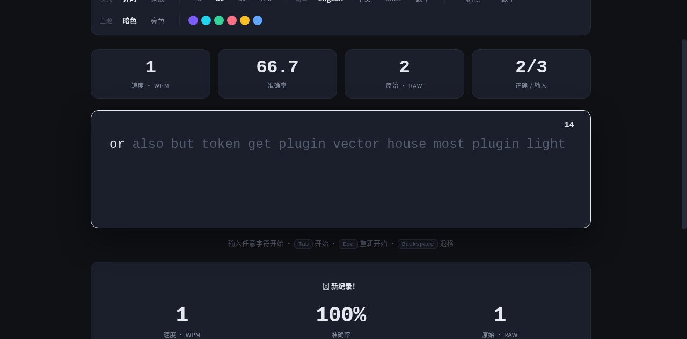

<div align="center">

# ⚡ TypeFlow

> 让打字变成一种心流 · Turn typing into a flow state

**现代化、本地优先、零依赖的打字测试应用**

🧪 实时 WPM · 🕐 双模式 · 🗂️ 多词库 · 🎨 主题美化 · 📊 成绩趋势

[简体中文](#简体中文) · [繁體中文](#繁體中文) · [English](#english)

</div>

---

---

# 简体中文

## 🎉 项目介绍

**TypeFlow** 是一款**现代化、开箱即用、本地优先**的打字测试（Typing Test）Web 应用。它把打字测速这件小事做到极致：**实时速度反馈、精准准确率统计、丰富的模式与词库、精美的主题系统**，并且**完全无需后端、无需构建、可离线运行**。

### 解决的用户痛点
- 😩 打字测速工具要么臃肿复杂、要么广告满天飞 —— TypeFlow 干净纯粹，**零广告、零追踪**
- 😵 大多数测速工具只测英文，对中文/程序员/数字输入场景支持差 —— TypeFlow 内置 **中文、英文、代码、数字** 四套词库
- 🔒 担心隐私与数据去向 —— TypeFlow **100% 本地运行**，成绩仅存于浏览器 `localStorage`，**数据不出本机**
- 🎨 千篇一律的界面 —— TypeFlow 内置 **暗色/亮色双主题 × 6 种强调色**，个性十足

### 自研差异化亮点
不依赖任何第三方框架与运行时，**纯原生 HTML/CSS/JavaScript 实现**，单文件级轻量，任意静态服务器甚至直接双击 `index.html` 即可运行。相比业界主流打字工具，我们在**多语言支持、本地化持久化、主题个性化**上做了差异化增强。

> 💡 灵感来源：向 Monkeytype 等打字社区致敬，同时针对中文用户与程序员场景做了本地化与工程化再造。

## ✨ 核心特性

- **⚡ 实时统计**：键入即反馈 **WPM 速度、准确率、RAW 原始速度、正确/输入字符数** 四项核心指标
- **🕐 双测试模式**：**计时模式**（15/30/60/120 秒）与 **词数模式**（10/25/50/100 词）自由切换
- **🗂️ 多词库**：**English / 中文 / Code / 数字** 四套词库，并可叠加 **标点** 与 **数字** 开关增加难度
- **🎨 主题系统**：**暗色 / 亮色** 双主题 × **紫/青/翡翠/玫瑰/琥珀/天蓝** 6 种强调色，一键切换即时生效
- **📊 本地成绩**：每次成绩自动存入浏览器 `localStorage`，**个人最佳（PB）自动标记**，生成 **WPM 趋势折线图**
- **📋 历史记录**：最近 10 条成绩清晰展示，支持一键清空
- **⌨️ 顺滑交互**：逐词逐字高亮、错误即时标红、光标平滑跟随、`Tab` 开始 / `Esc` 重开 / `Backspace` 退格
- **💾 偏好记忆**：主题、词库、模式等个性化设置自动记忆，下次打开保持
- **🚀 零依赖离线**：无任何第三方库、无网络请求，**可离线使用、可离线部署**

## 🚀 快速开始

### 环境要求
- 任意现代浏览器（Chrome / Edge / Firefox / Safari）
- 可选：Node.js ≥ 16（仅用于本地静态服务器）

### 方式一：直接打开（最快）
直接双击 `index.html` 即可使用，**无需任何环境**。

### 方式二：本地静态服务器（推荐）
```bash
# 克隆仓库
git clone https://github.com/gitstq/TypeFlow.git
cd TypeFlow

# 方式 A：使用 npm（自动调用 npx serve）
npm start

# 方式 B：使用 Python（无需 Node）
python3 -m http.server 5173

# 方式 C：使用任意静态服务器
npx serve .
```

打开浏览器访问 `http://localhost:5173` 即可开始。

## 📖 详细使用指南

### 基本操作
1. **开始测试**：点击输入面板聚焦，输入任意字符或按 `Tab` 键开始计时
2. **逐词输入**：按空格进入下一个词；输入错误字符会**即时标红**
3. **退格修正**：按 `Backspace` 回退修正错误
4. **重新开始**：按 `Esc` 或点击右上角刷新图标
5. **查看结果**：测试结束后自动展示 **WPM / 准确率 / RAW** 与 **趋势折线图**

### 模式与词库配置
| 配置项 | 可选值 | 说明 |
| --- | --- | --- |
| 模式 | 计时 / 词数 | 计时按秒计算，词数打完指定词数结束 |
| 时长 | 15 / 30 / 60 / 120 秒 | 计时模式下的时长 |
| 词数 | 10 / 25 / 50 / 100 | 词数模式下的目标词数 |
| 词库 | English / 中文 / Code / 数字 | 数字词库为随机数字串 |
| 标点 | 开 / 关 | 开启后单词随机附带标点 |
| 数字 | 开 / 关 | 开启后单词随机附带数字 |
| 主题 | 暗色 / 亮色 | 全局明暗切换 |
| 强调色 | 6 选 1 | 选中后即时生效 |

### 快捷键
| 按键 | 功能 |
| --- | --- |
| `Tab` | 开始测试 |
| `Esc` | 重新开始 |
| `Backspace` | 删除/退格 |
| `Space` | 进入下一个词 |

### 运行截图
> 🖼️ 界面预览（详见仓库 `assets/screenshot.png`）



## 💡 设计思路与迭代规划

### 设计理念
- **极简而不简陋**：克制配色、清晰层级、留白充足，让注意力集中在打字本身
- **本地优先**：所有数据本地化，尊重隐私，离线可用
- **工程化**：零依赖但要工程化，依赖管理、贡献指南、文档完备

### 技术选型
- **原生 HTML/CSS/JS**：无需构建、加载极快、跨平台兼容、易二次开发
- **CSS 变量**：实现主题与强调色的优雅切换
- **localStorage**：实现成绩与偏好的本地持久化

### 后续迭代计划
- [ ] 自定义词库导入（支持文本/JSON）
- [ ] 逐键实时错误率曲线
- [ ] 多语言界面（i18n）
- [ ] 键盘布局可视化提示
- [ ] PWA 离线安装支持
- [ ] 句子模式（语义连贯文本）

### 社区贡献方向
欢迎任何形式的贡献：新词库、新主题、性能优化、无障碍（a11y）改进、Bug 修复等。

## 📦 打包与部署指南

本项目为**纯前端静态应用**，无需编译打包。

### 本地部署
- 将整个项目目录部署到任意静态托管（GitHub Pages / Nginx / Vercel / Netlify 等）即可
- 示例：GitHub Pages 直接托管仓库根目录

### 环境兼容
- 浏览器：Chrome 80+ / Edge 80+ / Firefox 78+ / Safari 14+
- 移动端：自适应响应式布局，触屏可用
- 系统：Windows / macOS / Linux 全平台

## 🤝 贡献指南

- 请先阅读 [CONTRIBUTING.md](docs/CONTRIBUTING.md)
- 提交规范遵循 [Angular Commit Convention](https://www.conventionalcommits.org/)
- 发起 PR 前请完成本地自测

## 📄 开源协议说明

本项目基于 **MIT 协议** 开源，详见 [LICENSE](LICENSE)。你可以自由使用、修改、分发，甚至商用，仅需保留版权声明。

---

---

# 繁體中文

## 🎉 專案介紹

**TypeFlow** 是一款**現代化、開箱即用、本地優先**的打字測試（Typing Test）Web 應用。它把打字測速做到極致：**即時速度回饋、精準正確率統計、豐富的模式與詞庫、精美的佈景主題**，並且**完全不需要後端、不需建置、可離線執行**。

### 解決的痛點
- 😩 打字測速工具不是臃腫就是廣告滿天飛 —— TypeFlow 乾淨純粹，**零廣告、零追蹤**
- 😵 多數工具只測英文，對中文/程式/數字場景支援差 —— TypeFlow 內建 **中文、英文、程式碼、數字** 四套詞庫
- 🔒 擔心隱私與資料去向 —— TypeFlow **100% 本地執行**，成績僅存於瀏覽器 `localStorage`，**資料不出本機**
- 🎨 千篇一律的介面 —— TypeFlow 內建 **暗色/亮色雙主題 × 6 種強調色**，個性十足

### 自研差異化亮點
**純原生 HTML/CSS/JavaScript** 實作，零依賴、零框架，單檔級輕量，任意靜態伺服器甚至直接開啟 `index.html` 即可執行。在**多語言支援、本地化持久化、主題個人化**上做了差異化強化。

> 💡 靈感來源：向 Monkeytype 等打字社群致敬，並針對中文使用者與程式開發者場景做了在地化與工程化再造。

## ✨ 核心特色
- **⚡ 即時統計**：即時顯示 **WPM 速度、正確率、RAW 原始速度、正確/輸入字元數**
- **🕐 雙測試模式**：**計時模式**（15/30/60/120 秒）與 **詞數模式**（10/25/50/100 詞）
- **🗂️ 多詞庫**：**English / 中文 / Code / 數字** 四套詞庫，可疊加 **標點** 與 **數字** 開關
- **🎨 主題系統**：**暗色/亮色** 雙主題 × **紫/青/翡翠/玫瑰/琥珀/天藍** 6 種強調色
- **📊 本地成績**：成績存入 `localStorage`，**個人最佳（PB）自動標記**，生成 **WPM 趨勢折線圖**
- **📋 歷史紀錄**：最近 10 條成績展示，支援一鍵清空
- **⌨️ 順暢互動**：逐詞逐字高亮、錯誤即時標紅、游標平滑跟隨
- **💾 偏好記憶**：主題、詞庫、模式等設定自動記憶
- **🚀 零依賴離線**：無第三方庫、無網路請求，**可離線使用、可離線部署**

## 🚀 快速開始
### 環境要求
- 任意現代瀏覽器（Chrome / Edge / Firefox / Safari）
- 選配：Node.js ≥ 16（僅用於本地靜態伺服器）

### 方式一：直接開啟（最快）
直接雙擊 `index.html` 即可使用，**無需任何環境**。

### 方式二：本地靜態伺服器（建議）
```bash
git clone https://github.com/gitstq/TypeFlow.git
cd TypeFlow
npm start          # 或
python3 -m http.server 5173   # 或
npx serve .
```
開啟瀏覽器造訪 `http://localhost:5173` 即可開始。

## 📖 詳細使用指南
### 基本操作
1. **開始測試**：點擊輸入面板聚焦，輸入任一字元或按 `Tab` 開始計時
2. **逐詞輸入**：按空白鍵進入下一個詞；錯誤字元**即時標紅**
3. **退格修正**：按 `Backspace` 回退修正
4. **重新開始**：按 `Esc` 或點擊右上角重新整理圖示
5. **查看結果**：結束後自動展示 **WPM / 正確率 / RAW** 與 **趨勢折線圖**

### 模式與詞庫配置
| 設定項 | 可選值 | 說明 |
| --- | --- | --- |
| 模式 | 計時 / 詞數 | 計時按秒計算，詞數打完指定詞數結束 |
| 時長 | 15 / 30 / 60 / 120 秒 | 計時模式的時長 |
| 詞數 | 10 / 25 / 50 / 100 | 詞數模式的目標詞數 |
| 詞庫 | English / 中文 / Code / 數字 | 數字詞庫為隨機數字串 |
| 標點 | 開 / 關 | 單詞隨機附帶標點 |
| 數字 | 開 / 關 | 單詞隨機附帶數字 |
| 主題 | 暗色 / 亮色 | 全域明暗切換 |
| 強調色 | 6 選 1 | 選中即時生效 |

### 快捷鍵
| 按鍵 | 功能 |
| --- | --- |
| `Tab` | 開始測試 |
| `Esc` | 重新開始 |
| `Backspace` | 刪除/退格 |
| `Space` | 進入下一個詞 |

### 執行截圖


## 💡 設計思路與規劃
- **極簡而不簡陋**：克制配色、清晰層級、留白充足
- **本地優先**：資料在地化，尊重隱私，離線可用
- **工程化**：零依賴但要工程化，依賴管理、貢獻指南、文件完備

### 後續迭代
- [ ] 自訂詞庫匯入（支援文字/JSON）
- [ ] 逐鍵即時錯誤率曲線
- [ ] 多語言介面（i18n）
- [ ] 鍵盤佈局視覺化提示
- [ ] PWA 離線安裝
- [ ] 句子模式

## 📦 打包與部署指南
純前端靜態應用，**無需編譯打包**。將整個目錄部署到任意靜態托管（GitHub Pages / Nginx / Vercel / Netlify）即可。
- 瀏覽器：Chrome 80+ / Edge 80+ / Firefox 78+ / Safari 14+
- 系統：Windows / macOS / Linux 全平台

## 🤝 貢獻指南
請先閱讀 [CONTRIBUTING.md](docs/CONTRIBUTING.md)，提交遵循 [Angular Commit Convention](https://www.conventionalcommits.org/)。

## 📄 開源協議說明
基於 **MIT 協議** 開源，詳見 [LICENSE](LICENSE)。

---

---

# English

## 🎉 About

**TypeFlow** is a **modern, out-of-the-box, local-first** typing test web app. It takes typing speed measurement to the next level with **real-time feedback, precise accuracy stats, rich modes & word sets, and a beautiful theme system** — all **fully backend-free, build-free, and offline-capable**.

### Pain Points Solved
- 😩 Typing tools are either bloated or ad-ridden — TypeFlow is **clean, zero-ads, zero-tracking**
- 😵 Most tools only support English — TypeFlow ships **Chinese, English, Code, and Numbers** word sets
- 🔒 Worried about privacy — TypeFlow runs **100% locally**, results stay in browser `localStorage`, **data never leaves your machine**
- 🎨 Cookie-cutter UIs — TypeFlow offers **dark/light themes × 6 accent colors**

### Differentiators
Built with **pure vanilla HTML/CSS/JavaScript** — zero dependencies, tiny footprint, runs on any static server or even by opening `index.html` directly. We differentiate with **multi-language support, local persistence, and theme personalization**.

> 💡 Inspired by the typing community (Monkeytype & friends), rebuilt with localization and engineering polish for Chinese users and developers.

## ✨ Features
- **⚡ Live stats**: **WPM, accuracy, RAW speed, correct/typed chars** update as you type
- **🕐 Dual modes**: **Timed** (15/30/60/120s) and **Words** (10/25/50/100)
- **🗂️ Word sets**: **English / 中文 / Code / Numbers**, plus optional **punctuation & numbers** toggles
- **🎨 Themes**: **dark/light** × **6 accent colors**, applied instantly
- **📊 Local stats**: results persist to `localStorage`, **personal best (PB) auto-marked**, with a **WPM trend line chart**
- **📋 History**: last 10 results, one-click clear
- **⌨️ Smooth UX**: per-word highlighting, instant error marking, smooth caret, `Tab` start / `Esc` restart / `Backspace` undo
- **💾 Preference memory**: theme, word set, mode remembered across sessions
- **🚀 Zero-dependency offline**: no libraries, no network, **works offline & deploys anywhere**

## 🚀 Quick Start
### Requirements
- Any modern browser (Chrome / Edge / Firefox / Safari)
- Optional: Node.js ≥ 16 (for a local static server)

### Option 1: Open directly (fastest)
Double-click `index.html` — **no environment needed**.

### Option 2: Local static server (recommended)
```bash
git clone https://github.com/gitstq/TypeFlow.git
cd TypeFlow
npm start          # or
python3 -m http.server 5173   # or
npx serve .
```
Visit `http://localhost:5173` in your browser.

## 📖 Usage Guide
### Basics
1. **Start**: click the board to focus, type any character or press `Tab`
2. **Type word by word**: press `Space` for the next word; wrong chars turn **red instantly**
3. **Fix**: press `Backspace` to undo
4. **Restart**: press `Esc` or click the refresh icon
5. **Result**: after finishing, see **WPM / accuracy / RAW** and the **trend chart**

### Modes & Word Sets
| Setting | Options | Note |
| --- | --- | --- |
| Mode | Timed / Words | Timed by seconds, Words ends after target word count |
| Time | 15 / 30 / 60 / 120s | Duration in Timed mode |
| Words | 10 / 25 / 50 / 100 | Target word count in Words mode |
| Word set | English / 中文 / Code / Numbers | Numbers generates random digit strings |
| Punctuation | on/off | random punctuation attached to words |
| Numbers | on/off | random numbers attached to words |
| Theme | dark / light | global brightness |
| Accent | 6 options | applied instantly |

### Shortcuts
| Key | Action |
| --- | --- |
| `Tab` | Start test |
| `Esc` | Restart |
| `Backspace` | Undo |
| `Space` | Next word |

### Screenshot


## 💡 Design & Roadmap
- **Minimal but not crude**: restrained palette, clear hierarchy, generous whitespace
- **Local-first**: all data local, privacy-respecting, offline-capable
- **Engineering**: zero-dependency yet professional, with dependency management, contribution guide, and docs

### Roadmap
- [ ] Custom word set import (text/JSON)
- [ ] Per-key error curve
- [ ] i18n UI
- [ ] On-screen keyboard hint
- [ ] PWA offline install
- [ ] Sentence mode

## 📦 Packaging & Deployment
Pure static frontend — **no build step required**. Deploy the whole directory to any static host (GitHub Pages / Nginx / Vercel / Netlify).
- Browsers: Chrome 80+ / Edge 80+ / Firefox 78+ / Safari 14+
- OS: Windows / macOS / Linux

## 🤝 Contributing
Please read [CONTRIBUTING.md](docs/CONTRIBUTING.md) and follow the [Angular Commit Convention](https://www.conventionalcommits.org/) when submitting PRs.

## 📄 License
Licensed under the **MIT License**. See [LICENSE](LICENSE).